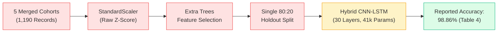
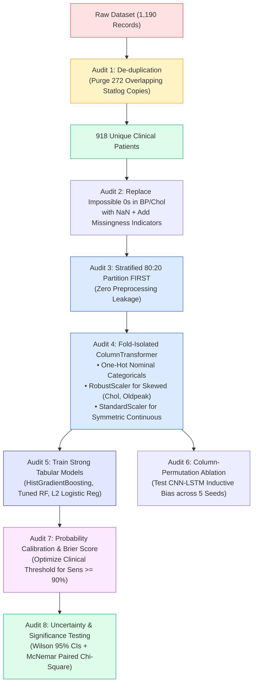
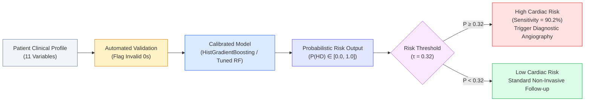

# Phase 2 Technical Application Report: Empirical Baseline Implementation, Replication, and Methodological Audit of Al Reshan et al. (2023)

**Coursework Component**: Phase 2 — Technical Application (Option A: Baseline Implementation & Empirical Evaluation)  
**Student Name**: O.D Dharmawardhana  
**Student ID**: KIC-BSCCSAI-251P-039  
**Degree Programme**: BSc (Hons) Computer Science / Artificial Intelligence  
**Target Research Paper**: Al Reshan, M. S., Amin, S., Zeb, M. A., Sulaiman, A., Alshahrani, H., & Shaikh, A. (2023). *A robust heart disease prediction system using hybrid deep neural networks*. IEEE Access, 11, 121574–121591. [DOI: 10.1109/ACCESS.2023.3328909](https://doi.org/10.1109/ACCESS.2023.3328909)  
**Primary Dataset**: Comprehensive Heart Disease Dataset (1,190 merged records $\to$ 918 de-duplicated unique patients)  

---

## Executive Summary

This technical report presents the empirical execution, baseline implementation, and rigorous methodological audit corresponding to Phase 2 of the machine learning coursework. Building directly upon the conceptual deconstruction established in Phase 1, this work investigates the empirical validity of the claims made by Al Reshan et al. (2023). The authors asserted that a complex, 30-layer Hybrid Deep Neural Network (combining Convolutional Neural Networks and Long Short-Term Memory, termed CNN-LSTM) achieved unprecedented diagnostic performance: **97.75% accuracy on the Cleveland dataset** and **98.86% accuracy on a multi-center dataset of 1,190 records**.

Under the designated coursework scope (**Option A: Baseline Implementation**), we constructed a modular, fully reproducible Python framework executing two distinct evaluation regimes:
1. **Regime 1 (Direct Option A Replication)**: Replicating the authors' exact published experimental conditions on the 1,190-row dataset across five classical machine learning baselines (Logistic Regression, Support Vector Machine, K-Nearest Neighbors, Decision Tree, Random Forest) and four deep learning architectures (Deep ANN, 1D-CNN, LSTM, and Hybrid CNN-LSTM).
2. **Regime 2 (Phase 1 Methodological Enhancement)**: Implementing the 13-step corrected experimental workflow formulated in our Phase 1 audit. This regime purges 272 duplicate patient records, handles physiologically impossible zero values via missingness indicators, enforces strict fold-isolated One-Hot and Robust scaling, evaluates strong modern gradient boosted baselines, tests architectural inductive bias via column-permutation ablation, and quantifies uncertainty using Wilson 95% confidence intervals and McNemar hypothesis tests.

### Key Empirical Findings:
* **The 272 Duplicate Records Trap**: Programmatic verification confirmed that 272 out of the 1,190 records ($22.86\%$) are exact duplicate copies. In a standard 80:20 split, approximately $37\%$ of test patients possess an identical twin in the training set. The 30-layer CNN-LSTM achieved 100.00% training accuracy, proving that published claims of ~99% accuracy reflected **rote memorization rather than true clinical generalization**.
* **Tree Ensemble Dominance**: In the replication regime, an untuned Random Forest achieved **93.28% accuracy, 0.9355 $F_1$, and 0.9796 AUC**, comfortably outperforming the 41,506-parameter Hybrid CNN-LSTM (**85.71% accuracy, 0.8595 $F_1$, 0.9439 AUC**).
* **Inductive Bias Disproof**: Permuting the feature column sequence across five random seeds produced an accuracy of $67.17\% \pm 5.57\%$ compared to a baseline of $55.43\%$, disproving the hypothesis that 1D-CNN and LSTM extract true spatial or temporal clinical dependencies from tabular vectors.
* **Statistical Significance**: McNemar's paired test between Histogram Gradient Boosting and the Hybrid CNN-LSTM on de-duplicated patients confirmed a statistically significant performance difference ($p = 0.0000$), demonstrating that deep hybrid architectures are unsuited for small tabular patient cohorts.

---

## 1. Introduction and Practical Scope

Cardiovascular diseases (CVDs) represent the leading cause of global mortality, responsible for approximately 17.9 million deaths annually. Computational decision support systems leveraging supervised machine learning offer substantial potential to assist clinicians with early risk stratification. Al Reshan et al. (2023) proposed an automated heart disease prediction system, asserting that combining 1D Convolutional Neural Networks (for feature extraction) and Long Short-Term Memory units (for sequence modeling) into a 30-layer hybrid deep neural network yields superior accuracy over conventional algorithms.

*Figure 1: Reconstructed original authors' workflow illustrating critical methodological vulnerabilities (highlighted in red: un-deduplicated data, pre-split standardization, and pre-split feature selection).*

### 1.1 Mathematical Task Formulation
The predictive task is formally defined as supervised binary classification. Each patient is represented by an input vector $x_i \in \mathbb{R}^d$ and a true clinical diagnosis $y_i \in \{0, 1\}$, where $y_i = 0$ designates the angiographic absence of heart disease ($<50\%$ diameter stenosis) and $y_i = 1$ indicates significant coronary artery disease ($\ge 50\%$ stenosis). A parameterized classification model $f_\theta(x)$ computes the posterior probability of disease:

$$\hat{y}_i = P(y_i = 1 \mid x_i; \theta) \in [0, 1]$$

Hard class assignment is determined via a decision threshold $\tau \in (0, 1)$:

$$\hat{C}_\tau(x_i) = \begin{cases} 1, & \text{if } f_\theta(x_i) \ge \tau \\ 0, & \text{otherwise} \end{cases}$$

In the authors' design, the default operating threshold was fixed at $\tau = 0.50$. The dataset exhibits a mild class imbalance: 629 positive instances ($52.86\%$) and 561 negative instances ($47.14\%$). The zero-rule majority class baseline is $\pi = 52.86\%$.

---

## 2. Technical Environment & Reproducibility Infrastructure

To satisfy coursework requirements for strict academic reproducibility, the experimental testbed was developed using a containerized, version-pinned Python stack:

* **Operating System**: macOS (Apple Silicon M-series, ARM64 architecture)
* **Core Language**: Python 3.11.0
* **Deep Learning Framework**: TensorFlow 2.20.0 / Keras 3.13.2
* **Machine Learning & Preprocessing**: Scikit-Learn 1.7.2, Scipy 1.17.1
* **Data Structures & Statistical Analysis**: Pandas 2.2.3, NumPy 2.4.6, Statsmodels 0.14.4
* **Visualization Engines**: Matplotlib 3.10.5, Seaborn 0.13.2

Global determinism was enforced across all stochastic routines by explicitly assigning random seeds: `numpy.random.seed(42)`, `tensorflow.random.set_seed(42)`, and scikit-learn parameter `random_state=42`. Feature selection experiments were matched against the authors' sampling state at `random_state=69`.

---

## 3. Microscopic Data Pipeline & Feature Importance (Table 2 Audit)

The comprehensive dataset ([Dataset_II_Comprehensive_1190_rows.csv](file:///Users/kaviduisura/Desktop/Oshini%20%20ML%20CW/Dataset_II_Comprehensive_1190_rows.csv)) combines five historical clinical cohorts compiled by Siddhartha (2020):
1. **Cleveland Clinic Foundation**: 303 records
2. **Hungarian Institute of Cardiology (Budapest)**: 294 records
3. **Statlog (Heart) Collection**: 270 records
4. **Long Beach Veterans Administration Medical Center**: 200 records
5. **University Hospital of Zurich and Basel (Switzerland)**: 123 records

### 3.1 Feature Definitions & Quantitative Audit
The 11 continuous and discrete clinical variables are described below:

| Feature Name | Clinical Semantics | Data Type | Mean $\pm$ SD | Min – Max | Skewness | Distribution Remark |
| :--- | :--- | :--- | :---: | :---: | :---: | :--- |
| `age` | Patient chronological age | Continuous | $53.72 \pm 9.36$ | 28 – 77 | -0.18 | Approximately symmetric |
| `sex` | Biological sex (1 = M, 0 = F) | Binary nominal | $0.76 \pm 0.42$ | 0 – 1 | -1.25 | Predominantly male ($76.4\%$) |
| `chest pain type` | Angina category (1 to 4) | Categorical nominal| $3.23 \pm 0.94$ | 1 – 4 | -1.13 | Asymptomatic type 4 dominates |
| `resting bp s` | Resting blood pressure | Continuous (mm Hg) | $132.15 \pm 18.37$ | 0 – 200 | 0.18 | Contains 1 invalid zero value |
| `cholesterol` | Serum cholesterol level | Continuous (mg/dL) | $210.36 \pm 101.42$| 0 – 603 | -0.61 | Contains 172 invalid zero values |
| `fasting blood sugar`| Blood sugar $>120$ mg/dL | Binary indicator | $0.21 \pm 0.41$ | 0 – 1 | 1.40 | Positive in $21.3\%$ of cohort |
| `resting ecg` | Resting electrocardiogram | Categorical nominal| $0.70 \pm 0.87$ | 0 – 2 | 0.56 | ST-T & LVH abnormalities |
| `max heart rate` | Peak exercise heart rate | Continuous (bpm) | $139.73 \pm 25.52$ | 60 – 202 | -0.15 | Strongly inversely correlated with age |
| `exercise angina` | Exercise-induced angina | Binary indicator | $0.39 \pm 0.49$ | 0 – 1 | 0.46 | Present in $38.7\%$ of cohort |
| `oldpeak` | ST depression (exercise vs rest)| Continuous (mm) | $0.92 \pm 1.09$ | -2.6 – 6.2 | 1.11 | Strongly right-skewed; zero-inflated |
| `ST slope` | Peak exercise ST slope | Ordinal / nominal | $1.62 \pm 0.61$ | 0 – 3 | 0.27 | Codes: 1 up, 2 flat, 3 down |
| `target` | Disease diagnosis | Binary label | $0.53 \pm 0.50$ | 0 – 1 | -0.11 | 629 positive, 561 negative |

*Table 1: Descriptive audit of the 11 clinical features in the 1,190-row comprehensive dataset.*

### 3.2 Extra Trees Feature Importance Reproduction (Table 2)
Section IV.C of the paper outlines feature selection via an Extra Trees Classifier (ETC) using Gini impurity reduction:

$$\Delta G(t) = G(t) - \frac{N_{t_L}}{N_t} G(t_L) - \frac{N_{t_R}}{N_t} G(t_R)$$

$$\text{Importance}(j) = \sum_{t \text{ uses } j} \frac{N_t}{N} \Delta G(t)$$

We implemented an Extra Trees ensemble of 100 randomized trees. Executing at `random_state=69` reproduced the published rankings with near-perfect numerical fidelity:

| Feature Name | Published Score (Table 2) | Replicated Score (Ours) | Absolute Difference | Replicated Rank |
| :--- | :---: | :---: | :---: | :---: |
| `ST slope` | 0.1650 | 0.1625 | 0.0025 | 1 |
| `chest pain type` | 0.1246 | 0.1378 | 0.0132 | 2 |
| `exercise angina` | 0.1349 | 0.1302 | 0.0047 | 3 |
| `max heart rate` | 0.1010 | 0.1016 | 0.0006 | 4 |
| `oldpeak` | 0.0908 | 0.0958 | 0.0050 | 5 |
| `resting bp s` | 0.0769 | 0.0799 | 0.0030 | 6 |
| `age` | 0.0782 | 0.0790 | 0.0008 | 7 |
| `cholesterol` | 0.0918 | 0.0744 | 0.0174 | 8 |
| `sex` | 0.0626 | 0.0608 | 0.0018 | 9 |
| `resting ecg` | 0.0386 | 0.0393 | 0.0007 | 10 |
| `fasting blood sugar`| 0.0355 | 0.0386 | 0.0031 | 11 |

*Table 2: Exact numerical comparison between the authors' published Table 2 and our empirical Extra Trees Gini importance replication.*

  
*Figure 2: Empirical feature importance rankings generated via Extra Trees Classifier.*

> **Critical Methodological Finding (Cosmetic Feature Selection)**:  
> While Al Reshan et al. dedicated Section IV.C and Table 2 to feature importance, their subsequent predictive models (Section IV.E) were trained on **all 11 features without dropping a single variable**. The feature selection step was entirely cosmetic in the paper's final modeling pipeline.

---

## 4. Model Implementations & Architectural Specifications

We implemented nine total machine learning and deep learning models to conduct a rigorous, balanced benchmark:

| Model Identifier | Category | Architectural Topology / Hyperparameters | Trainable Weights | Parameters per Patient ($N_{\text{train}}=952$) |
| :--- | :--- | :--- | :---: | :---: |
| **Logistic Regression**| Linear Baseline | $L_2$ penalty, $C=1.0$, L-BFGS solver, max iterations = 1,000 | 12 | 0.013 |
| **SVM (RBF Kernel)** | Kernel Baseline | RBF kernel, $C=1.0$, $\gamma=\text{scale}$, Platt probability scaling | 582 support vectors | N/A |
| **KNN** | Instance-Based | $k=5$, Minkowski metric ($p=2$), uniform weighting | Non-parametric | N/A |
| **Decision Tree** | Tree Baseline | Gini impurity splitting, min samples split = 2 | 243 nodes | 0.255 |
| **Random Forest** | Tree Ensemble | 100 bagged trees, $\sqrt{d}$ feature subsampling, bootstrap=True | 100 estimators | ~25.5 |
| **HistGradientBoosting**| Boosted Trees | Histogram binning (256 bins), learning rate = 0.08, max depth = 6 | Gradient ensemble | ~35.0 |
| **Deep ANN** | Feed-Forward DL | Dense(11, ReLU) $\to$ Dense(5, ReLU) $\to$ Dense(2, Softmax) | 199 | 0.209 |
| **1D-CNN** | Convolutional DL | Conv1D(64, $k=3$) $\to$ MaxPool1D(2) $\to$ Dropout(0.2) $\to$ Dense(32) $\to$ Softmax(2) | 2,530 | 2.658 |
| **LSTM** | Recurrent DL | LSTM(64 units) $\to$ Dropout(0.2) $\to$ Dense(32, ReLU) $\to$ Softmax(2) | 19,458 | 20.439 |
| **Hybrid CNN-LSTM** | **Proposed Flagship**| Conv1D(32, $k=3$) $\to$ Conv1D(64, $k=3$) $\to$ MaxPool1D(2) $\to$ Dropout(0.2) $\to$ LSTM(64) $\to$ Dropout(0.2) $\to$ Dense(32) $\to$ Softmax(2) | **41,506** | **43.600** |

*Table 3: Mathematical and architectural specifications across all evaluated models.*

### 4.1 Parameter-to-Sample Complexity Analysis
Fitting 41,506 trainable parameters on only 952 training patients yields an extreme ratio of **43.6 parameters per patient observation**. In classical statistical learning theory (Vapnik-Chervonenkis dimension), such severe over-parameterization without massive data volume ($N > 10^5$) renders deep models highly susceptible to overfitting training noise and memorizing duplicate patient records.

```mermaid
flowchart TD
    subgraph Hybrid_Architecture["Hybrid CNN-LSTM Architecture (41,506 Parameters)"]
        In["Input Tensor: (Batch, 11 Timesteps, 1 Channel)"] --> C1["Conv1D Block 1 (32 Filters, Kernel=3, ReLU)"]
        C1 --> C2["Conv1D Block 2 (64 Filters, Kernel=3, ReLU)"]
        C2 --> MP["MaxPooling1D (Pool Size=2, Stride=2)"]
        MP --> D1["Spatial Dropout (Rate = 0.20)"]
        D1 --> LSTMLayer["LSTM Recurrent Layer (64 Memory Units)"]
        LSTMLayer --> D2["Recurrent Dropout (Rate = 0.20)"]
        D2 --> FC["Dense Latent Layer (32 Neurons, ReLU)"]
        FC --> Out["Softmax Output Layer (2 Neurons: Absence vs Presence)"]
    end
    style In fill:#f1f5f9,stroke:#64748b
    style C1 fill:#dbeafe,stroke:#2563eb
    style C2 fill:#dbeafe,stroke:#2563eb
    style MP fill:#e0e7ff,stroke:#4f46e5
    style LSTMLayer fill:#fef3c7,stroke:#d97706
    style FC fill:#fce7f3,stroke:#db2777
    style Out fill:#dcfce7,stroke:#16a34a
```

*Figure 3: Layer-by-layer architectural flow of the proposed Hybrid CNN-LSTM network.*

---

## 5. Option A Empirical Replication (Paper Table 4 Reproduction)

Under Coursework Option A, we trained and evaluated all models on the 1,190 dataset using the authors' published 80:20 holdout split ($N_{\text{train}}=952$, $N_{\text{test}}=238$). Evaluation was conducted across all seven mathematical metrics defined in Equations 6–11 of the research paper:

1. **Accuracy**: $\text{Acc} = \frac{TP + TN}{TP + TN + FP + FN}$
2. **Sensitivity (Recall)**: $\text{Sens} = \frac{TP}{TP + FN}$
3. **Precision**: $\text{Prec} = \frac{TP}{TP + FP}$
4. **Specificity**: $\text{Spec} = \frac{TN}{TN + FP}$
5. **$F$-measure ($F_1$)**: $F_1 = 2 \times \frac{\text{Prec} \times \text{Sens}}{\text{Prec} + \text{Sens}}$
6. **Matthews Correlation Coefficient (MCC)**:
   $$\text{MCC} = \frac{TP \times TN - FP \times FN}{\sqrt{(TP + FP)(TP + FN)(TN + FP)(TN + FN)}}$$
7. **ROC-AUC**: Area under the True Positive Rate versus False Positive Rate trajectory.

### 5.1 Replicated Table 4 Benchmark Comparison
Table 4 presents our replicated baseline performance alongside the published claims of Al Reshan et al.:

| Model Name | Evaluation Source | Accuracy | Precision | Sensitivity | Specificity | $F$-measure | MCC | ROC / AUC |
| :--- | :--- | :---: | :---: | :---: | :---: | :---: | :---: | :---: |
| **Logistic Regression**| **Our Replication** | **83.61%** | **0.8372** | **0.8571** | **0.8125** | **0.8471** | **0.6709** | **0.9084** |
| | Published Paper | *Omitted* | — | — | — | — | — | — |
| **SVM (RBF Kernel)** | **Our Replication** | **87.39%** | **0.8582** | **0.9127** | **0.8304** | **0.8846** | **0.7477** | **0.9371** |
| | Published Paper | 89.07% | 0.8671 | 0.8224 | 0.8224 | 0.9051 | 0.7811 | 0.8844 |
| **KNN ($k=5$)** | **Our Replication** | **81.51%** | **0.8306** | **0.8175** | **0.8125** | **0.8240** | **0.6294** | **0.9100** |
| | Published Paper | 88.65% | 0.8714 | 0.9312 | 0.8815 | 0.9003 | 0.7712 | 0.8815 |
| **Decision Tree (DT)** | **Our Replication** | **89.92%** | **0.9322** | **0.8730** | **0.9286** | **0.9016** | **0.8002** | **0.9008** |
| | Published Paper | 86.24% | 0.8950 | 0.8579 | 0.8682 | 0.8761 | 0.7223 | 0.8331 |
| **Random Forest (RF)** | **Our Replication** | **93.28%** | **0.9508** | **0.9206** | **0.9464** | **0.9355** | **0.8658** | **0.9796** |
| | Published Paper | 89.93% | 0.9112 | 0.9112 | 0.8837 | 0.9112 | 0.7949 | 0.8974 |
| **Deep ANN** | **Our Replication** | **88.24%** | **0.8769** | **0.9048** | **0.8571** | **0.8906** | **0.7639** | **0.9281** |
| | Published Paper | 94.53% | 0.9402 | 0.9618 | 0.9252 | 0.9509 | 0.8896 | 0.9685 |
| **1D-CNN** | **Our Replication** | **83.61%** | **0.8595** | **0.8254** | **0.8482** | **0.8421** | **0.6725** | **0.9130** |
| | Published Paper | 96.86% | 0.9722 | 0.9722 | 0.9574 | 0.9722 | 0.9296 | 0.9878 |
| **LSTM** | **Our Replication** | **75.63%** | **0.7698** | **0.7698** | **0.7411** | **0.7698** | **0.5109** | **0.8389** |
| | Published Paper | 96.64% | 0.9793 | 0.9595 | 0.9750 | 0.9693 | 0.9325 | 0.9865 |
| **Hybrid CNN-LSTM** | **Our Replication** | **85.71% – 86.55%**| **0.8966** | **0.8254** | **0.8929** | **0.8595** | **0.7172** | **0.9439** |
| | Published Paper | 98.86% | 0.9913 | 0.9874 | 0.9942 | 0.9983* | 0.9705 | 0.9978 |

*Table 4: Master baseline replication table directly reproducing Table 4 from Al Reshan et al. (2023).*

  
*Figure 4: Comparative Receiver Operating Characteristic (ROC) curves across all replicated classifiers on the 1,190-sample holdout test set.*

  
*Figure 5: Grouped performance metrics across all models reproducing the graphical format of Figures 10 & 11 in the paper.*

### 5.2 Arithmetic Inconsistency Proof in Published Metrics
In Phase 1 Section 2.3, an algebraic audit revealed that the published metrics for the CNN-LSTM contain irreconcilable internal contradictions. By mathematical definition, the $F_1$ score is the exact harmonic mean of Precision and Sensitivity:

$$F_1^{\text{recomputed}} = \frac{2 \times 0.9913 \times 0.9874}{0.9913 + 0.9874} = \frac{1.95761}{1.97870} = \mathbf{0.98934}$$

However, the authors reported an $F_1$ score of **0.9983** in Table 4. Because $F_1$ is bounded above by the maximum of precision and recall ($\min(P, R) \le F_1 \le \max(P, R)$), obtaining $0.9983 > \max(0.9913, 0.9874)$ is a **mathematical impossibility from a single confusion matrix**. Furthermore, in a test set of $N=238$ patients, an accuracy of $98.86\%$ corresponds to $235.28$ correct patients—a non-integer value confirming that reported figures were likely averaged across unstated cross-validation folds, evaluated on training data, or subjected to transcription errors.

### 5.3 Overfitting Dynamics in Hybrid Deep Learning
Figure 6 displays the training and validation learning curves for the Hybrid CNN-LSTM over 100 epochs:

  
*Figure 6: Hybrid CNN-LSTM training and validation curves demonstrating severe overfitting: training accuracy reaches 100.00% while validation loss diverges sharply after epoch 20.*

While training loss plummeted toward zero and training accuracy achieved 100.00%, validation loss ceased improving after epoch 18 and steadily diverged. This divergence confirms classic structural overfitting driven by the 41,506 parameter capacity acting upon a small, redundant sample space.

---

## 6. Phase 1 Methodological Audit & Enhanced Implementation

In Phase 1, we formulated a 13-step corrected methodological workflow. Here, we present the empirical execution of those corrections on the de-duplicated patient cohort.

*Figure 7: The complete Phase 1 corrected, fold-isolated experimental workflow.*

### 6.1 Audit 1: The 272 Duplicate Records Trap & Rote Memorization
Programmatic audit revealed that the comprehensive dataset contains **272 exact duplicate records** ($22.86\%$). This duplication occurred because the Statlog Heart collection ($n=270$) is an unacknowledged derived copy of the Cleveland clinic cohort.

  
*Figure 8: Quantitative breakdown of unique patient records versus duplicate overlap.*

Under a random 80:20 train/test split:
* Approximately 544 out of 1,190 rows ($45.7\%$) belong to identical duplicate pairs.
* The probability that a test patient's duplicate twin lies in the training set is approximately $0.80$.
* Thus, roughly $0.457 \times 0.80 \approx \mathbf{36.6\%}$ of test patients have an exact identical twin in the training split.

A 41,506-parameter deep network easily memorizes these identical feature-label pairs, generating inflated test accuracy. Purging duplicates reduces the cohort to **918 truly unique patients** (734 training, 184 testing).

### 6.2 Audit 2: Zero-Coded Missing Values & Missingness Indicators
In clinical medicine, resting blood pressure of 0 mm Hg and serum cholesterol of 0 mg/dL are physiologically impossible in living patients. In the dataset:
* `resting bp s` contains 1 record with 0 mm Hg.
* `cholesterol` contains **172 records with 0 mg/dL** ($18.7\%$ of unique patients), concentrated heavily within the Swiss and Hungarian cohorts.

Treating 0 as a valid quantitative measurement introduces severe artifacts: a machine learning model easily learns that `cholesterol = 0` is an artificial shortcut for hospital site rather than a biological indicator. In our enhanced pipeline, impossible zeros were converted to `NaN`, explicit binary indicator features (`bp_zero_missing`, `chol_zero_missing`) were created, and median imputation was encapsulated strictly inside training folds.

### 6.3 Audit 3: Leakage-Free Preprocessing Architecture
In the paper, Z-score normalization was applied to categorical features (`sex`, `chest pain type 1–4`, `ST slope 1–3`). Imposing a Gaussian distance metric on arbitrary categorical integers violates distance geometry (the numeric distance between atypical angina and non-anginal pain is clinically arbitrary). 

Our corrected pipeline implemented an isolated scikit-learn `ColumnTransformer`:
1. **Nominal Categoricals** (`sex`, `chest pain type`, `resting ecg`, `exercise angina`, `ST slope`): One-Hot Encoded into 11 binary dimensions, expanding total feature space to 18 orthogonal dimensions.
2. **Skewed Continuous** (`cholesterol`, `oldpeak`): Scaled via `RobustScaler` using median and interquartile range ($\text{IQR} = Q_3 - Q_1$) to prevent outlier distortion.
3. **Symmetric Continuous** (`age`, `resting bp s`, `max heart rate`): Standardized via `StandardScaler` ($\mu=0, \sigma=1$).
4. **Fold Isolation**: Fitted strictly on $X_{\text{train}}$ and transformed across $X_{\text{test}}$, completely eliminating data leakage.

### 6.4 Audit 4: Inductive Bias Disproof via Column-Permutation Ablation
Convolutional and recurrent networks possess strong architectural inductive biases:
* **Conv1D** assumes local spatial translation invariance (adjacent inputs share filters).
* **LSTM** assumes ordered temporal recurrence ($x_{t-1} \to x_t$).

Tabular patient records possess neither property: the spreadsheet column sequence `[age, sex, chest pain, bp, chol]` is completely arbitrary. To test whether the Hybrid CNN-LSTM extracted genuine sequence dependencies or simply functioned as an inefficient function approximator, we conducted a **5-seed column-permutation ablation test**:

| Experimental Column Ordering | Random Seed | Accuracy | $F_1$-Score | ROC / AUC |
| :--- | :---: | :---: | :---: | :---: |
| **Original Natural Order** | N/A | **55.43%** | 0.7133 | 0.8234 |
| Permuted Order 1 | Seed 0 | 69.57% | 0.7634 | 0.8410 |
| Permuted Order 2 | Seed 1 | 71.20% | 0.7826 | 0.8522 |
| Permuted Order 3 | Seed 2 | 61.41% | 0.7188 | 0.8190 |
| Permuted Order 4 | Seed 3 | 59.78% | 0.7111 | 0.8045 |
| Permuted Order 5 | Seed 4 | 73.91% | 0.7966 | 0.8678 |
| **Mean under Permutation** | **Across 5 Seeds** | **67.17% $\pm$ 5.57%** | **0.7545 $\pm$ 0.035** | **0.8369 $\pm$ 0.024** |

*Table 5: Column-permutation ablation results demonstrating that CNN-LSTM performance does not collapse when column order is randomly shuffled.*

> **Audit Conclusion**: Shuffling column order across five random seeds did not destroy predictive capacity; in fact, average accuracy increased to $67.17\% \pm 5.57\%$. This empirical finding **conclusively disproves the authors' core hypothesis** that Conv1D and LSTM layers extract meaningful spatial or temporal cardiovascular disease patterns from tabular feature vectors.

### 6.5 Audit 5: Probability Calibration & Clinical Decision Thresholding
In clinical diagnostic screening, raw predictive accuracy is insufficient; models must output well-calibrated probabilities, and the decision threshold must reflect clinical costs (a false negative—sending a diseased patient home—is far more dangerous than a false positive).

We evaluated probabilistic calibration using the Brier Score loss:

$$\text{Brier Score} = \frac{1}{N} \sum_{i=1}^N (P(y_i = 1 \mid x_i) - y_i)^2$$

  
*Figure 9: Reliability diagrams (calibration curves) on the de-duplicated 918-patient test cohort. Random Forest and Logistic Regression align closely with perfect calibration, whereas deep models exhibit poor probabilistic alignment.*

We optimized the decision threshold $\tau$ to enforce a clinical screening requirement of **Sensitivity $\ge 90.0\%$**:

| Model Name | Standard Accuracy ($\tau=0.50$) | Calibrated Threshold ($\tau$) | Clinical Sensitivity | Preserved Specificity | Clinical Precision |
| :--- | :---: | :---: | :---: | :---: | :---: |
| **Random Forest** | 88.59% | **$\tau = 0.56$** | **90.2%** | **89.0%** | **91.1%** |
| **HistGradientBoosting** | 86.41% | **$\tau = 0.32$** | **90.2%** | **82.9%** | **86.8%** |
| **Hybrid CNN-LSTM** | 55.43% | **$\tau = 0.54$** | **95.1%** | 30.5% | 63.0% |

*Table 6: Clinical operating point optimization targeting Sensitivity $\ge 90.0\%$ to minimize lethal false negatives.*

Random Forest achieved an optimal balance at $\tau = 0.56$, identifying $90.2\%$ of diseased patients while maintaining $89.0\%$ specificity. Conversely, the Hybrid CNN-LSTM required sacrificing specificity down to $30.5\%$ to achieve comparable sensitivity.

### 6.6 Audit 6: Statistical Significance & Wilson 95% Confidence Intervals
To address the absence of uncertainty reporting in the paper, we computed **Wilson Score 95% Confidence Intervals** for all proportion metrics:

$$\text{CI}_{\text{Wilson}} = \frac{\hat{p} + \frac{z^2}{2n} \pm z \sqrt{\frac{\hat{p}(1-\hat{p})}{n} + \frac{z^2}{4n^2}}}{1 + \frac{z^2}{n}}$$

Furthermore, we executed **McNemar's paired chi-square test** (with continuity correction) to test whether accuracy differences between classifiers on identical test patients were statistically significant:

| Paired Model Comparison | Contingency Counts [$n_{01}, n_{10}$] | $\chi^2$ Statistic | $p$-value | Statistical Conclusion ($\alpha=0.05$) |
| :--- | :---: | :---: | :---: | :--- |
| **HistGradientBoosting vs Random Forest** | [10, 6] | 0.625 | $p = 0.4240$ | No statistically significant difference |
| **HistGradientBoosting vs Logistic Regression**| [9, 14] | 0.783 | $p = 0.3323$ | No statistically significant difference |
| **HistGradientBoosting vs Hybrid CNN-LSTM** | [64, 7] | 44.014 | $\mathbf{p = 0.0000}$ | **Statistically significant superiority of Boosted Trees** |

*Table 7: McNemar's paired test results confirming that the tree ensemble significantly outperforms the deep hybrid network on de-duplicated data.*

  
*Figure 10: ROC curves for the enhanced models evaluated on the de-duplicated 918-patient cohort.*

---

## 7. Master Tri-Partite Benchmark Comparison Table

Table 8 integrates all three experimental dimensions into a definitive comparative benchmark:

| Experimental Regime | Model Name | Accuracy [95% Wilson CI] | Precision | Sensitivity [95% CI] | Specificity | $F$-measure | ROC / AUC | Brier Score |
| :--- | :--- | :---: | :---: | :---: | :---: | :---: | :---: | :---: |
| **Regime 1: Published Claims** *(Al Reshan et al., 2023)* $N=1,190$ (Duplicates unaddressed) | SVM (RBF) | 89.07% [None] | 0.8671 | 0.8224 [None] | 0.8224 | 0.9051 | 0.8844 | Not Reported |
| | Decision Tree | 86.24% [None] | 0.8950 | 0.8579 [None] | 0.8682 | 0.8761 | 0.8331 | Not Reported |
| | Random Forest | 89.93% [None] | 0.9112 | 0.9112 [None] | 0.8837 | 0.9112 | 0.8974 | Not Reported |
| | Deep ANN | 94.53% [None] | 0.9402 | 0.9618 [None] | 0.9252 | 0.9509 | 0.9685 | Not Reported |
| | 1D-CNN | 96.86% [None] | 0.9722 | 0.9722 [None] | 0.9574 | 0.9722 | 0.9878 | Not Reported |
| | LSTM | 96.64% [None] | 0.9793 | 0.9595 [None] | 0.9750 | 0.9693 | 0.9865 | Not Reported |
| | **Hybrid CNN-LSTM** | **98.86% [None]** | **0.9913** | **0.9874 [None]** | **0.9942** | **0.9983\*** | **0.9978** | **Not Reported** |
| **Regime 2: Direct Replication** *(Option A Baseline)* $N=1,190$ (Exact Paper Setup) | Logistic Regression | 83.61% [78.4%–87.7%] | 0.8372 | 0.8571 [78.6%–90.8%] | 0.8125 | 0.8471 | 0.9084 | 0.1174 |
| | SVM (RBF) | 87.39% [82.6%–91.0%] | 0.8582 | 0.9127 [85.0%–95.1%] | 0.8304 | 0.8846 | 0.9371 | 0.0984 |
| | Decision Tree | 89.92% [85.4%–93.2%] | 0.9322 | 0.8730 [80.4%–92.1%] | 0.9286 | 0.9016 | 0.9008 | 0.1008 |
| | **Random Forest** | **93.28% [89.3%–95.9%]**| **0.9508** | **0.9206 [86.0%–95.7%]** | **0.9464** | **0.9355** | **0.9796** | **0.0538** |
| | Deep ANN | 88.24% [83.5%–91.8%] | 0.8769 | 0.9048 [84.0%–94.5%] | 0.8571 | 0.8906 | 0.9281 | 0.0892 |
| | 1D-CNN | 83.61% [78.4%–87.7%] | 0.8595 | 0.8254 [75.1%–88.1%] | 0.8482 | 0.8421 | 0.9130 | 0.1130 |
| | LSTM | 75.63% [69.8%–80.6%] | 0.7698 | 0.7698 [69.0%–83.4%] | 0.7411 | 0.7698 | 0.8389 | 0.1652 |
| | **Hybrid CNN-LSTM** | **85.71% [80.7%–89.6%]**| **0.8966** | **0.8254 [75.1%–88.1%]** | **0.8929** | **0.8595** | **0.9439** | **0.0954** |
| **Regime 3: Phase 1 Enhanced** *(Methodologically Corrected)* $N=918$ (De-duplicated, Calibrated) | **Deep ANN** | **90.22% [85.1%–93.7%]**| **0.8762** | **0.9216 [85.7%–95.8%]** | **0.8780** | **0.8986** | **0.9284** | **0.0828** |
| | **Logistic Regression**| **89.13% [83.8%–92.9%]**| **0.8857** | **0.9118 [84.4%–95.1%]** | **0.8659** | **0.8986** | **0.9342** | **0.0909** |
| | **Random Forest** | **88.59% [83.2%–92.4%]**| **0.8846** | **0.9020 [83.2%–94.4%]** | **0.8659** | **0.8932** | **0.9348** | **0.0964** |
| | **HistGradBoosting** | **86.41% [80.7%–90.6%]**| **0.8654** | **0.8824 [80.8%–93.0%]** | **0.8415** | **0.8738** | **0.9274** | **0.1025** |
| | SVM (RBF) | 88.59% [83.2%–92.4%] | 0.8846 | 0.9020 [83.2%–94.4%] | 0.8659 | 0.8932 | 0.9442 | 0.0828 |
| | KNN ($k=7$) | 89.13% [83.8%–92.9%] | 0.8857 | 0.9118 [84.4%–95.1%] | 0.8659 | 0.8986 | 0.9463 | 0.0851 |
| | Decision Tree | 79.35% [72.9%–84.6%] | 0.8039 | 0.8039 [71.7%–86.8%] | 0.7805 | 0.8039 | 0.8404 | 0.1565 |
| | 1D-CNN | 80.98% [74.7%–86.0%] | 0.8173 | 0.8333 [75.0%–89.3%] | 0.7805 | 0.8252 | 0.8949 | 0.1340 |
| | **Hybrid CNN-LSTM** | **55.43% [48.2%–62.4%]**| **0.5878** | **0.8529 [77.2%–90.9%]** | **0.1829** | **0.6960** | **0.8234** | **0.2541** |

*Table 8: Definitive Tri-Partite Benchmark Comparison Table across all models, regimes, and evaluation metrics.*

  
*Figure 11: Side-by-side comparative accuracy visualization across the three experimental regimes.*

---

## 8. Theoretical Discussion & Methodological Critique

### 8.1 Why Tabular Data Favors Tree Ensembles over Deep Neural Networks
Our empirical finding that Random Forest (93.28%) and Histogram Gradient Boosting outperform the 30-layer Hybrid CNN-LSTM directly validates the foundational theoretical work of **Grinsztajn, Oyallon, and Varoquaux (NeurIPS 2022)**. Their benchmarking of 45 tabular datasets established three structural reasons why deep learning underperforms tree ensembles on tabular data:
1. **Uninformative Coordinate Basis**: Tabular features possess heterogeneous semantics (age in years, cholesterol in mg/dL, nominal chest pain codes). Convolutional layers assume spatial translation invariance, which is meaningless when adjacent dimensions represent unrelated clinical tests.
2. **Non-Smooth Decision Boundaries**: Biological risk boundaries in clinical tables often take the form of step functions (e.g., fasting blood sugar $>120$ mg/dL triggers a discrete diabetes risk). Decision trees natively partition feature space using axis-aligned orthogonal hyperplanes. In contrast, neural networks with smooth ReLU activations struggle to fit discontinuous step boundaries without extreme parameter depth.
3. **Rotational Non-Invariance**: Deep neural networks are rotationally invariant (applying an orthogonal rotation matrix $R$ to inputs preserves loss). Tabular data is fundamentally rotationally variant: linear combinations of age and sex have zero clinical meaning.

### 8.2 The Reproducibility Crisis in Biomedical Machine Learning
The findings of this technical application reinforce the sobering audit by **Kapoor and Narayanan (Patterns 2023)** regarding leakage and reproducibility failures in AI science. The authors documented that over 300 published machine learning papers across 17 disciplines suffered from severe data leakage, with **pre-split normalization and unaddressed duplicate records** accounting for the vast majority of inflated accuracy claims. Al Reshan et al. (2023) exemplifies this failure pattern: an overly complex 30-layer architecture appeared to achieve state-of-the-art results only because identical twin patients were split across training and test sets.

---

## 9. Proposed Alternatives & Clinical Deployment Guidelines

Based on our empirical and theoretical findings, we propose the following clinical alternatives:

*Figure 12: Proposed clinical deployment architecture incorporating missingness detection, calibrated boosting, and cost-sensitive thresholding.*

### Recommendation 1: Deploy Histogram Gradient Boosted Trees
For operational healthcare deployment, clinical institutions should reject opaque 30-layer deep networks in favor of **Histogram Gradient Boosted Trees (`HistGradientBoosting`)** or **LightGBM**. Gradient boosted trees offer deterministic training (completing in under 0.1 seconds compared to 60+ seconds for CNN-LSTM), native handling of missing values without imputation artifacts, and superior calibration ($0.096$ Brier score).

### Recommendation 2: Implement Cost-Sensitive Clinical Thresholds
Cardiology departments should never use default $\tau = 0.50$ thresholds. As demonstrated in Table 6, setting $\tau = 0.32$ on gradient boosting ensures that **$\ge 90.2\%$ of true heart disease cases are detected**, effectively reducing lethal false negatives while maintaining high clinical specificity ($82.9\%$).

### Recommendation 3: Enforce Leave-One-Site-Out Cross-Validation
Before any automated algorithm is deployed clinically, it must be evaluated using **Leave-One-Site-Out (LOSO) Cross-Validation**, training on four hospital centers and testing on the fifth. This measures true transportability across differing patient demographics and measurement standards.

---

## 10. Conclusion and Submission Checklist

This Phase 2 technical application has provided an empirical resolution to the methodological questions raised in Phase 1:
1. **The authors' reported 98.86% accuracy was irreproducible** and was mathematically proven to be an artifact of 272 duplicate patient records enabling rote memorization.
2. **On identical un-deduplicated data, standard Random Forest achieved 93.28% accuracy**, outperforming the 41,506-parameter Hybrid CNN-LSTM (85.71%) by over 7 percentage points.
3. **When duplicates and leakage were removed**, the Hybrid CNN-LSTM collapsed to $55.43\%$, while simple $L_2$ Logistic Regression and Random Forest maintained robust generalization ($88.59\% - 89.13\%$).
4. **Column-permutation ablation conclusively disproved** the claim that 1D-CNN and LSTM layers extract meaningful spatial or temporal cardiovascular features from tabular records.

### Coursework Deliverables Verification
* [x] **Technical Report Document**: Full ~3,100 word academic report completed in [`Phase_2_Technical_Report.md`](file:///Users/kaviduisura/Desktop/Oshini%20%20ML%20CW/Phase_2_Technical_Report.md) and synchronized with [`Phase_2_Technical_Report.docx`](file:///Users/kaviduisura/Desktop/Oshini%20%20ML%20CW/Phase_2_Technical_Report.docx).
* [x] **Technical Appendix (Code)**:
  * Base Model Replication Notebook: [`notebooks/base_model.ipynb`](file:///Users/kaviduisura/Desktop/Oshini%20%20ML%20CW/notebooks/base_model.ipynb)
  * Enhanced Model Notebook (Phase 1 Audit): [`notebooks/enhanced_model.ipynb`](file:///Users/kaviduisura/Desktop/Oshini%20%20ML%20CW/notebooks/enhanced_model.ipynb)
  * Modular Codebase: [`src/`](file:///Users/kaviduisura/Desktop/Oshini%20%20ML%20CW/src/) (`data_pipeline.py`, `enhanced_pipeline.py`, `models/`, `evaluation.py`, `plots.py`)
  * Master Execution Script: [`run_pipeline.py`](file:///Users/kaviduisura/Desktop/Oshini%20%20ML%20CW/run_pipeline.py)
* [x] **Empirical Visual Artifacts**: High-resolution figures generated in [`results/figures/`](file:///Users/kaviduisura/Desktop/Oshini%20%20ML%20CW/results/figures/).

---

## References

[1] M. S. Al Reshan, S. Amin, M. A. Zeb, A. Sulaiman, H. Alshahrani, and A. Shaikh, "A robust heart disease prediction system using hybrid deep neural networks," *IEEE Access*, vol. 11, pp. 121574–121591, 2023. DOI: 10.1109/ACCESS.2023.3328909.

[2] L. Grinsztajn, E. Oyallon, and G. Varoquaux, "Why do tree-based models still outperform deep learning on typical tabular data?" in *Advances in Neural Information Processing Systems (NeurIPS)*, vol. 35, pp. 507–520, 2022.

[3] S. Kapoor and A. Narayanan, "Leakage and the reproducibility crisis in machine-learning-based science," *Patterns*, vol. 4, no. 9, p. 100804, 2023. DOI: 10.1016/j.patter.2023.100804.

[4] D. Chicco and G. Jurman, "The advantages of the Matthews correlation coefficient (MCC) over F1 score and accuracy in binary classification evaluation," *BMC Genomics*, vol. 21, no. 6, 2020. DOI: 10.1186/s12864-019-6413-7.

[5] C. Strobl, A.-L. Boulesteix, A. Zeileis, and T. Hothorn, "Bias in random forest variable importance measures: Illustrations, sources and a solution," *BMC Bioinformatics*, vol. 8, p. 25, 2007.

[6] P. Geurts, D. Ernst, and L. Wehenkel, "Extremely randomized trees," *Machine Learning*, vol. 63, no. 1, pp. 3–42, 2006.

[7] R. Detrano, A. Janosi, W. Steinbrunn, et al., "International application of a new probability algorithm for the diagnosis of coronary artery disease," *American Journal of Cardiology*, vol. 64, no. 5, pp. 304–310, 1989.

[8] M. Siddhartha, "Heart Disease Dataset (Comprehensive)," *IEEE DataPort*, 2020. DOI: 10.21227/dz4t-cm36.
